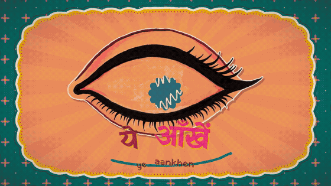
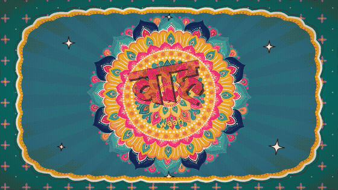
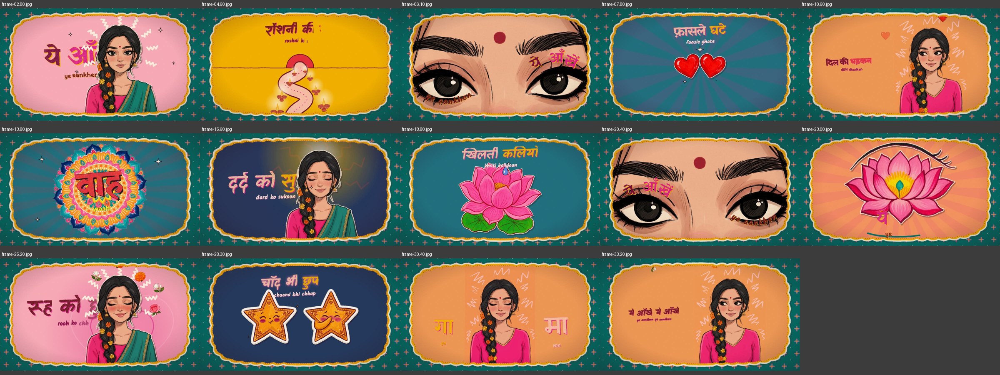

# desi-lyric-film

**A Claude skill that turns any song into a hand-drawn, Indian-maximalist lyric music video.**

Give Claude a song and (optionally) pictures of your character. You get back a 16:9 lyric film where:

- an illustrated character carries the emotion of every line — shy, aching, healed, dreaming, moved — with real
  stop-motion expression swaps and blinks
- every refrain is an **eye moment**: her eyes fill the frame, the lyric curves along her eyelids
- the lyrics are **extracted from your audio automatically** and written word-by-word in **Devanagari with the Roman line under it**,
  each word landing on its sung syllable
- outfits and background colours **change on the beat** (look cards), inside one ornate frame that never cuts
- the whole thing moves like hand-drawn animation: drawings on twos, boiling ink lines, paper cut-outs, a pen that draws the
  outline before the colour fills in

<p align="center">
  
  
  
</p>

<p align="center"></p>

▶ **Demo film** (silent, original demo lines): [`examples/01-demo-ye-aankhen/demo-720p.mp4`](examples/01-demo-ye-aankhen/demo-720p.mp4)

## What you need

- **Claude Code** (or Claude Desktop / claude.ai with skills)
- **The Atlabs MCP** — required. The character art (base design, expressions, eye close-ups, outfit looks) is generated with
  Atlabs using **Nano Banana 2.1**, **GPT Image 2.5 Sunburst** or **Seedream 5**. [How to connect →](docs/atlabs-mcp.md)
- **Node 18+**, **Python 3.12**, **ffmpeg**, and Google Chrome (for rendering)
- The song as an audio file you have (mp3 / wav / m4a)

## Install

**As a plugin (Claude Code)** — the Atlabs MCP comes bundled:
```
/plugin marketplace add Chinmaya123-cyber/desi-lyric-film
/plugin install desi-lyric-film@desi-lyric-film
```
Then `/mcp` → **atlabs** → sign in.

**As a skill only:** copy `skills/desi-lyric-film` into `~/.claude/skills/`, and connect Atlabs yourself
(`claude mcp add --transport http atlabs https://mcp.atlabs.ai/mcp`, then `/mcp` → atlabs → sign in).

Full steps: [docs/installation.md](docs/installation.md)

## Use it

Just ask, with your song attached or its path:

> Make a lyrical music video for the hook of `~/Music/song.mp3` in the desi hand-drawn style — use my character images in `~/Pictures/me/`

> Turn the chorus of this song into an animated lyric video with an original desi baddie character, Devanagari + English lyrics

Claude will ask a few quick questions (which part, your character or an original one, the vibe), then do the rest:
song analysis → automatic lyrics → character art on Atlabs → shot plan → render. More prompts: [docs/example-prompts.md](docs/example-prompts.md)

## What's inside

```
skills/desi-lyric-film/
  SKILL.md              the workflow Claude follows
  references/           style guide (palette, typography, motion spec), Atlabs, character, lyrics, shot design, rendering
  template/             a complete Remotion project: data-driven film engine + audio, lyrics and character tools
examples/               the demo film, stills, character and look-card sheets, example film.json / character.json
docs/                   installation, Atlabs MCP, example prompts, how it works
```

How it works, in one picture: [docs/how-it-works.md](docs/how-it-works.md)

## Credits & notes

- Image generation spends Atlabs credits — a full film uses roughly 25–40 with Nano Banana 2.1.
- Use your own audio. Lyrics are taken only from the audio you provide (or text you provide). Publishing rights for the song
  are yours to sort out; some platforms mute commercial music.
- Use photos of yourself or people who agreed to it, or character art you have rights to.

MIT licence — see [LICENSE](LICENSE).
